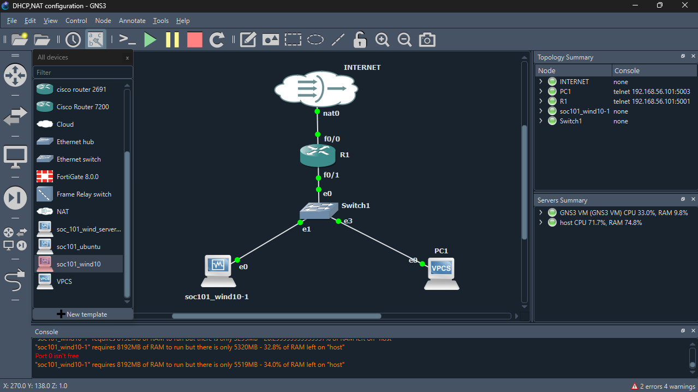
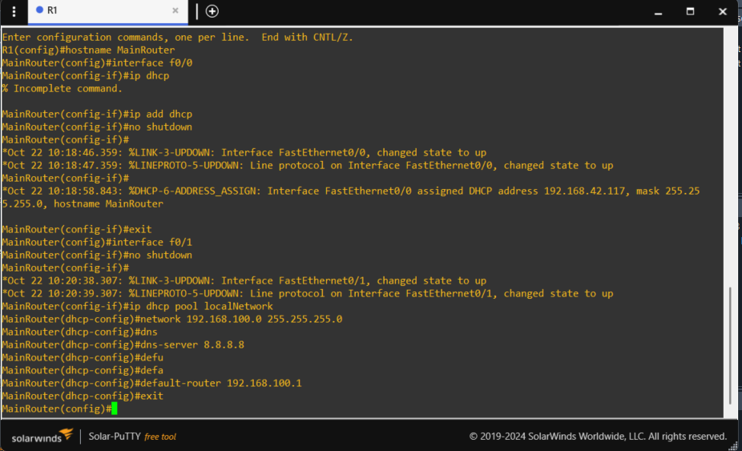
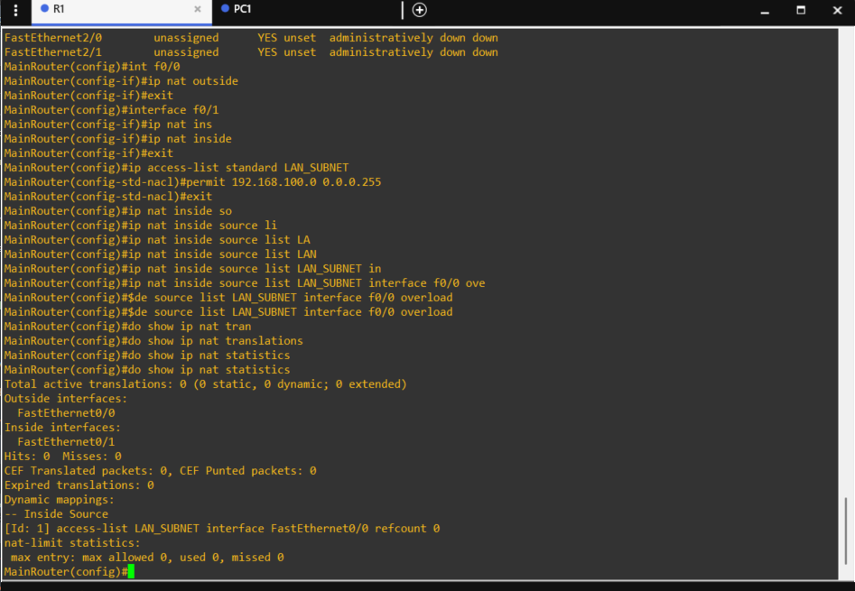
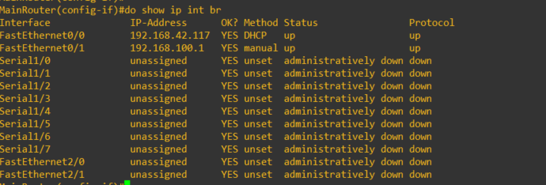
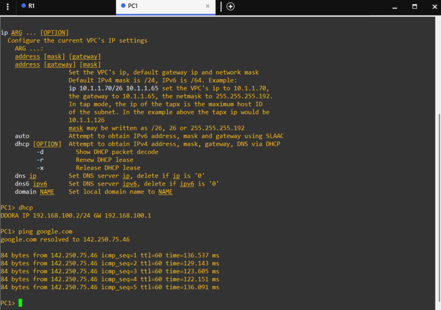
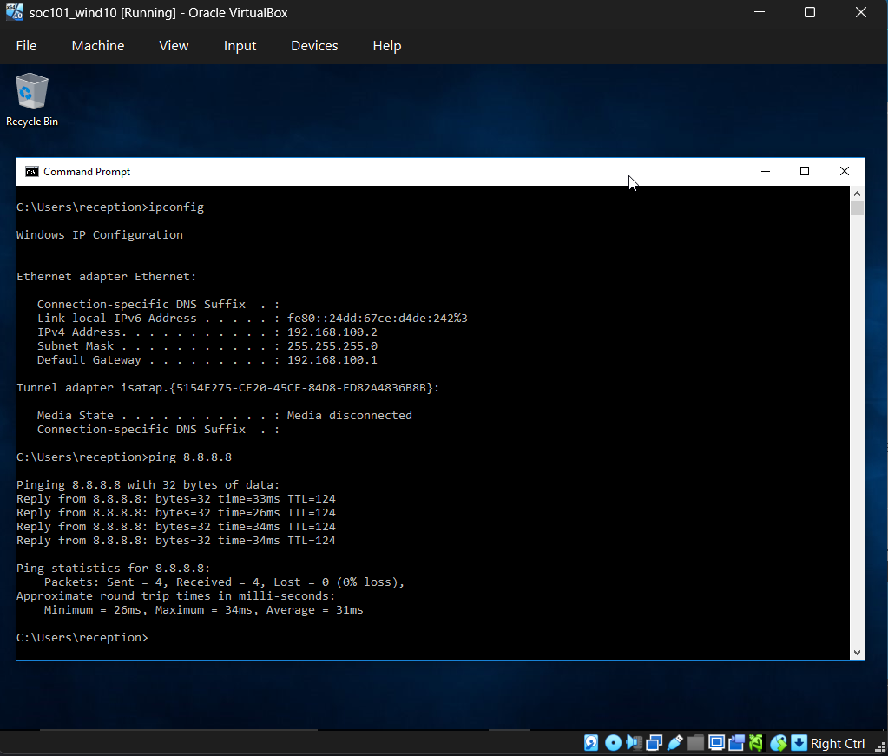

# GNS3 Lab: DHCP and NAT Configuration

## Overview

This project demonstrates the configuration of a Cisco IOS router acting as both a **DHCP Server** for an internal LAN and a **NAT (Network Address Translation) Gateway** to provide internet access to internal hosts. 

The lab was built using **GNS3** to simulate a real-world enterprise edge router setup where the WAN interface dynamically receives an IP via DHCP from the ISP, while the LAN interface manages internal IP allocation.

## Objective

- Configure R1 to act as a DHCP server for the `192.168.100.0/24` network.
- Configure R1's WAN interface (`f0/0`) as a DHCP client to obtain a public IP from the simulated ISP.
- Implement NAT Overload (PAT) to allow internal LAN devices to access external networks.
- Verify connectivity using VPCs and a Windows 10 Virtual Machine.

## Architecture / Topology

**Addressing Scheme:**
| Device | Interface | IP Address | Role |
| :--- | :--- | :--- | :--- |
| R1 | f0/0 (WAN) | DHCP (e.g., `192.168.42.117`) | NAT Outside |
| R1 | f0/1 (LAN) | `192.168.100.1/24` | NAT Inside / Default Gateway |
| PC1 (VPC) | e0 | DHCP (`192.168.100.2`) | Internal Host |
| SOC101 (Win10) | e0 | DHCP (`192.168.100.3`) | Internal Host |

## Technologies & Tools

| Category | Tools / Protocols |
| :--- | :--- |
| Simulation | GNS3, VirtualBox |
| Platform | Cisco IOS (c2691) |
| Networking | DHCP, NAT/PAT, IPv4, ACLs |
| Testing | VPC (Virtual PC Simulator), Windows 10 |

## How It Works

1. **WAN DHCP Client:** Interface `f0/0` is configured with `ip address dhcp`, allowing the router to pull an IP from the GNS3 NAT cloud (simulating an ISP).
2. **LAN DHCP Server:** An IP pool (`localNetwork`) is created on R1 to hand out IPs in the `192.168.100.0/24` range, providing `8.8.8.8` as the DNS server and `192.168.100.1` as the default gateway.
3. **NAT/PAT:** 
   - A standard ACL (`LAN_SUBNET`) identifies traffic from the internal network that is allowed to be translated.
   - `ip nat inside source list LAN_SUBNET interface f0/0 overload` translates all internal IPs to the single public IP address of the WAN interface using Port Address Translation (PAT).

## Setup / Reproduction

1. Open the GNS3 project file (if uploaded to repo).
2. Start all devices.
3. Apply the configurations found in [`configs/R1-config.txt`](configs/R1-config.txt).
4. On the VPC, run `dhcp -r` to request an IP address.
5. On the Windows VM, open Command Prompt and run `ipconfig /renew`.

## Verification & Evidence

### 1. DHCP Configuration on R1
The router is successfully configured to hand out IPs on the local network.

### 2. NAT Configuration and Table
The NAT inside/outside interfaces are configured, and the ACL is applied. The translation table proves the router is handling traffic.

### 3. Interface Status
The WAN interface (`f0/0`) successfully obtained a dynamic IP (`192.168.42.117`), and the LAN interface (`f0/1`) is up.

### 4. Client Verification (VPC)
The VPC successfully obtained an IP via DHCP and can ping external IPs (`8.8.8.8`) and resolve DNS (`google.com`).

### 5. Client Verification (Windows 10)
A Windows 10 VM on the same network successfully obtained an IP via DHCP and tested external connectivity.

## Security Considerations

- **NAT is not a firewall:** While NAT hides internal IP addresses, an extended ACL should be applied on the WAN interface in a real production environment to explicitly block unsolicited inbound traffic.
- **DHCP Snooping:** In a production network with physical switches, DHCP snooping should be implemented to prevent rogue DHCP servers.
- **DNS Security:** The lab uses `8.8.8.8` (Google DNS) for simplicity. Enterprise environments should use internal, filtered DNS servers.

## Lessons Learned

- **Interface Boundaries:** NAT requires explicit `ip nat inside` and `ip nat outside` commands on the correct interfaces. A common mistake is forgetting to apply this to the LAN interface, which breaks translation.
- **GNS3 DHCP Environments:** Working with the GNS3 NAT cloud requires ensuring the VirtualBox/VMware host network adapter is properly bridging to the host's internet connection so the router can pull a WAN IP.
- **VPC Commands:** The VPC uses specific commands like `dhcp -r` to release/renew IPs, which differ from standard Cisco IOS CLI.

## Future Improvements

- [ ] Add an extended ACL to restrict outbound traffic from specific LAN hosts.
- [ ] Configure a Layer 2 switch with VLANs between R1 and the end hosts.
- [ ] Implement a static NAT entry (Port Forwarding) to allow external access to a web server hosted on the Windows 10 VM.

---
*Disclaimer: This project is for educational purposes only. Do not apply these configurations directly to production equipment without proper review.*
